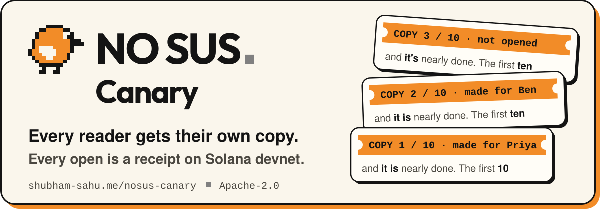
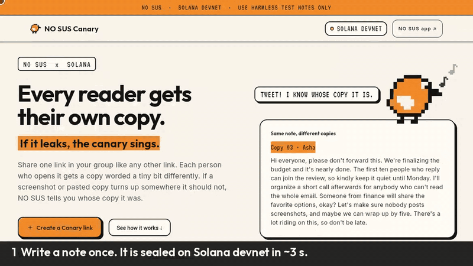
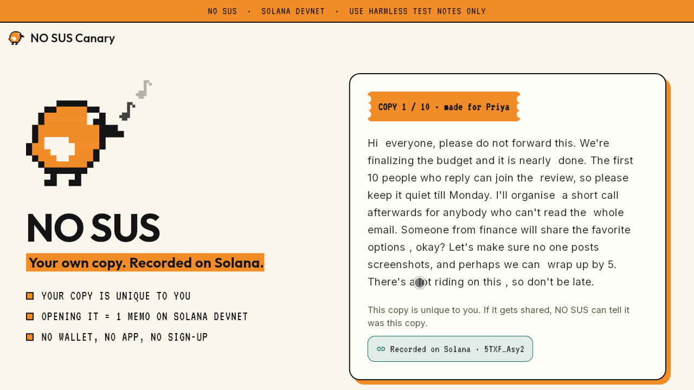
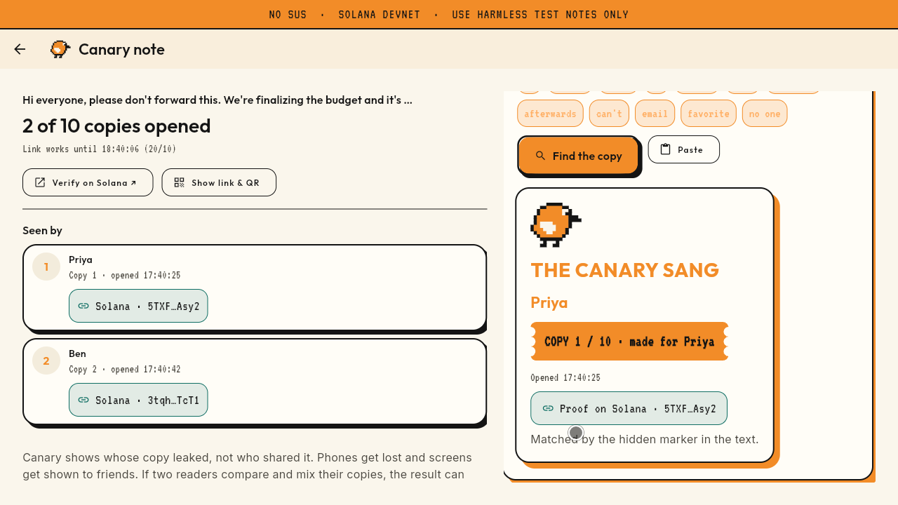
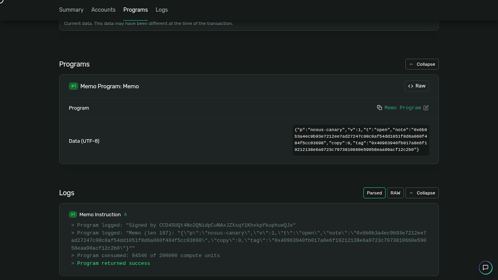
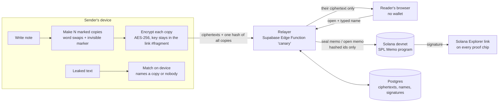

<p align="center">
  <a href="https://shubham-sahu.me/nosus-canary/"></a>
</p>

<p align="center">
  <a href="https://github.com/https-shubhamsahu/nosus-canary/actions/workflows/ci.yml"></a>
</p>

<p align="center">
  <a href="https://shubham-sahu.me/nosus-canary/"><b>Live demo</b></a> ·
  <a href="https://github.com/https-shubhamsahu/nosus-canary/releases/download/v0.1.0/nosus-canary-pitch.mp4">Pitch video (2:24)</a> ·
  <a href="https://github.com/https-shubhamsahu/nosus-canary/releases/download/v0.1.0/nosus-canary-demo.mp4">Demo video (1:18)</a> ·
  <a href="https://explorer.solana.com/tx/5TXFPfTDFWyVe98DVPph7r55uRdJAcih6vKMBBRJKA96KtWT7Q4MUoFQG6GwH8N1FFkiMMbZzPssGtqtoW3wAsy2?cluster=devnet">A real receipt</a> ·
  <a href="SECURITY.md">Security model</a> ·
  <a href="SUBMISSION.md">Reviewer FAQ</a>
</p>

Salary sheets, offer letters, exam papers and investor decks leak as screenshots, and nobody can show whose copy it was. Canary gives every reader of a note a secretly different copy. When text leaks, you paste it in and Canary names the copy it came from. Every seal and every open is written to Solana devnet, so the record of who got which copy isn't just our word. Readers don't need a wallet, an app or an account.

<p align="center">
  
</p>
<p align="center"><sub>Recorded on the live site on 20 Oct 2026, no edits to the app.
Receipts from this run:
<a href="https://explorer.solana.com/tx/QqdiqT84UfFyHNhpfLrK32HfqbUB5vF8qtC4DiAQ7wZZGn2MkUVJGGpVPpgmk4MCxVLtkhmZm6rbuBxqyuL11wb?cluster=devnet">seal</a> ·
<a href="https://explorer.solana.com/tx/5TXFPfTDFWyVe98DVPph7r55uRdJAcih6vKMBBRJKA96KtWT7Q4MUoFQG6GwH8N1FFkiMMbZzPssGtqtoW3wAsy2?cluster=devnet">Priya's open</a> ·
<a href="https://explorer.solana.com/tx/3tqhYUQ2BppvWh6dy8q5u7U23NpZ7FqfAnd34B58GTriGVZXtykcPj1i4sF7bNh4t8ShnhQokySNz7Uwh7GMTcT1?cluster=devnet">Ben's open</a>.
<a href="docs/media/canary-demo.mp4">MP4 version</a>.</sub></p>

## How a leak gets matched

<p align="center">
  
</p>

1. **You write the note once.** Your browser finds the words that have a safe twin: `don't` / `do not`, `ten` / `10`, `until` / `till`, `organize` / `organise`, from a fixed list of 148 swaps. We keep swappable words at least three words apart and use up to 24 per note. The app's demo note has 15.
2. **Every copy gets a codeword.** One bit per swappable word: 0 keeps your word, 1 uses its twin. Codewords are random and distinct, and kept at least 4 bits apart when the note has room, so even a few surviving words separate copies. An invisible marker (zero-width characters carrying the copy number) is also hidden after the 1st, 11th, 21st word and so on.
3. **Your browser encrypts each copy** with AES-256, and the key stays in the link's `#fragment`, so we never see it. A **seal** memo goes to Solana with one hash of all copies before anyone reads.
4. **Readers type a name and get the next unused copy.** Their open is another memo, paid by our relayer.
5. **You paste the leak.** If the marker survived, it names the copy outright. If it was stripped by retyping or OCR, Canary reads each swappable word it can find, using the words around it, and keeps only copies that agree. With fewer than 3 readable words, or more than one copy left, it names nobody. Matching runs on your device.

The board above uses the demo note's real 15 slots and Priya's real copy from the screenshots below. We drew the other nine codewords the way the app draws them.

<table>
  <tr>
    <td width="33%"></td>
    <td width="33%"></td>
    <td width="33%"></td>
  </tr>
  <tr>
    <td align="center"><sub>Each reader gets their own copy</sub></td>
    <td align="center"><sub>A pasted leak names the copy</sub></td>
    <td align="center"><sub>Every open is a memo on Solana</sub></td>
  </tr>
</table>

## Receipts you can check now

A receipt is one SPL Memo instruction with one signature, so it pays the 5,000-lamport base fee (0.000005 SOL) and confirms in about a second. In the recording above, the link was ready about 3 s after clicking Create, encryption and confirmation included. Once it's written, nobody can edit a receipt: not you, not the reader, not us. Anyone can read it on Solana Explorer without trusting our database.

| Receipt | Signature | Memo |
|---|---|---|
| Seal, 10 copies (20 Oct 2026) | [`QqdiqT84…uL11wb`](https://explorer.solana.com/tx/QqdiqT84UfFyHNhpfLrK32HfqbUB5vF8qtC4DiAQ7wZZGn2MkUVJGGpVPpgmk4MCxVLtkhmZm6rbuBxqyuL11wb?cluster=devnet) | `{"p":"nosus-canary","v":1,"t":"seal","note":"0x6b0b…3698","copies":10,"hash":"0x…","exp":…}` |
| Open, copy 1 (Priya) | [`5TXFPfTD…oW3wAsy2`](https://explorer.solana.com/tx/5TXFPfTDFWyVe98DVPph7r55uRdJAcih6vKMBBRJKA96KtWT7Q4MUoFQG6GwH8N1FFkiMMbZzPssGtqtoW3wAsy2?cluster=devnet) | `{"p":"nosus-canary","v":1,"t":"open","note":"0x6b0b…3698","copy":0,"tag":"0x4096…c2b0"}` |
| Open, copy 2 (Ben) | [`3tqhYUQ2…h7GMTcT1`](https://explorer.solana.com/tx/3tqhYUQ2BppvWh6dy8q5u7U23NpZ7FqfAnd34B58GTriGVZXtykcPj1i4sF7bNh4t8ShnhQokySNz7Uwh7GMTcT1?cluster=devnet) | same note, `"copy":1` |
| First seal ever (10 Oct 2026) | [`2BHqnuCx…FRk512bQ`](https://explorer.solana.com/tx/2BHqnuCxYyemfegHkncgTsQyMPjpyB9boD1XqYfD1Wtbcf51Fpy3y264UwGhnvRKtcxFKCaSAzHxLrDwFRk512bQ?cluster=devnet) | `"t":"seal"`, 3 copies |
| All receipts | [relayer `CCD4SUQt…hueQJx`](https://explorer.solana.com/address/CCD4SUQt4No2QNidpCuNAxJZXsqY1KhxkpfkuphueQJx?cluster=devnet) | |

Decode any receipt yourself, without our app or server:

```bash
deno run --allow-net packages/receipts-ts/cli.ts 5TXFPfTDFWyVe98DVPph7r55uRdJAcih6vKMBBRJKA96KtWT7Q4MUoFQG6GwH8N1FFkiMMbZzPssGtqtoW3wAsy2
```

## Run it locally in under 5 minutes

You need [Flutter](https://docs.flutter.dev/get-started/install) 3.47+ and Chrome. The app talks
to the hosted devnet backend with its public (publishable) key, so there is nothing else to set up.

```bash
git clone https://github.com/https-shubhamsahu/nosus-canary.git
cd nosus-canary/app
flutter pub get
flutter run -d chrome --dart-define=NOSUS_CANARY_ONLY=true
```

Run the checks that CI runs (add [Deno](https://deno.com) 2.x for the last three):

```bash
(cd app && flutter analyze && flutter test)
(cd packages/receipts-dart && dart pub get && dart analyze && dart test)
(cd packages/receipts-ts && deno test)
(cd app/supabase/functions/canary && deno check index.ts && deno test --allow-env)
```

Your own backend and relayer: [docs/SELF_HOSTING.md](docs/SELF_HOSTING.md). Secrets template:
[.env.example](.env.example).

<a name="more"></a>
## Implementation and limits



| Where | What it holds | What it never holds |
|---|---|---|
| Solana (public) | Hashed note id, copy count, one hash of all copies, expiry, copy number, salted reader tag | Note text, keys, names, device ids |
| Server (Supabase) | Encrypted copies, reader names and open times (shown to the sender), signatures | Note text, the decryption key |
| Sender's device | The note, every copy's fingerprint, the owner secret | |
| The link | Note id and the AES key, in the `#fragment` (browsers never send it to a server) | |

**How often matching is right.** Measured by `app/tool/canary_fingerprint_harness.dart`, which CI runs, on a note with 15 swappable words like the demo note:

| Leak | 20 copies | 50 copies | 100 copies |
|---|---|---|---|
| Full copy without the invisible marker, OCR-style text, 2% typos | 300 / 300 each, 0 wrong | 300 / 300 each, 0 wrong | 300 / 300 each, 0 wrong |
| Partial excerpts: named / wrong | 431 / 600, 0 wrong | 313 / 600, 0 wrong | 188 / 600, 0 wrong |
| Two copies blended: an innocent reader named | 1 / 600 | 8 / 600 | 23 / 600 |

**What a receipt proves.** That the NO SUS relayer recorded this seal or this open at this time, and that the note's copies were committed before anyone read them. It doesn't prove who a person is, that a human read the text, or who shared a leak. Canary names *whose copy* leaked; phones get lost and screens get shown to friends.

**What it can't do yet.**

- It doesn't stop screenshots. It makes them traceable.
- A reader who rewrites the text in their own words can defeat it, and two readers who blend their copies can confuse the match (rates above).
- We encrypt copies with AES-256 in CTR mode, without an authentication tag. AES-GCM is on the roadmap.
- Our server could give two readers the same copy or skip a receipt. The seal commits to every copy first, so your device can check any copy a reader shows you against it.
- On chain there are only sha256-based ids and hashes. The reader tag is salted with a server secret and bound to the note and copy, so tags can't be linked across notes.
- No secrets in the repo. The whole history (46 commits, all branches) was scanned on 20 Oct 2026; the only key found is the Supabase publishable key, which is public by design.

Full threat model and how to report a problem: [SECURITY.md](SECURITY.md). More detail: [docs/ARCHITECTURE.md](docs/ARCHITECTURE.md) and the receipt format in [docs/RECEIPTS_SPEC.md](docs/RECEIPTS_SPEC.md).

## Roadmap

| Next | What | Status |
|---|---|---|
| **Mainnet** | Receipts on Solana mainnet-beta with priority fees, retries with backoff, and relayer key rotation | Devnet live |
| **Open-source receipts library** | `@nosus/receipts` (TypeScript) and `nosus_receipts` (Dart): encode, parse, send, fetch and verify Canary receipts, with shared test vectors | **v0.1 in [`packages/`](packages/)**; the live relayer runs it; not yet published to JSR, npm or pub.dev |
| **Solana dApp Store / Seeker** | Canary inside the NO SUS Android app, submitted to the Solana dApp Store | Android build exists; not submitted |
| **PDFs and images** | Per-copy marks for files, not only text | Not started |
| **Merkle / compressed batching** | Many opens in one transaction (a Merkle root per batch, or state compression) to cut cost at scale | Not started |
| **Authenticated encryption** | AES-GCM per copy, so a tampered copy fails to open | Not started |

## What's in this repo

| Path | What |
|---|---|
| [`app/`](app/) | The NO SUS Flutter app (web + Android). Canary lives in [`app/lib/features/canary/`](app/lib/features/canary/); the deployed site is the standalone build (`NOSUS_CANARY_ONLY=true`). |
| [`app/supabase/functions/canary/`](app/supabase/functions/canary/) | The relayer: one Supabase Edge Function (Deno) that stores ciphertexts and writes the Solana memos |
| [`app/supabase/migrations/`](app/supabase/migrations/) | Database schema, including `canary_notes` and `canary_copies` |
| [`packages/receipts-ts/`](packages/receipts-ts/) · [`packages/receipts-dart/`](packages/receipts-dart/) | The receipts library, v0.1, plus [shared test vectors](packages/test-vectors/) from real devnet transactions |
| [`docs/`](docs/) | Architecture, receipt spec, self-hosting, status and verification log |
| [`tool/solana-spike/`](tool/solana-spike/) | Script that sends a test seal and open memo to devnet with your own key |
| [`scripts/build_readme_assets.py`](scripts/build_readme_assets.py) | Rebuilds the README visuals in `assets/readme/` |

## Where it stands

We're early: live, pre-revenue, devnet only.

- **Live** at [shubham-sahu.me/nosus-canary](https://shubham-sahu.me/nosus-canary/) since 10 Oct 2026. As of 20 Oct 2026 the relayer had written 31 receipts (19 seals, 12 opens, 0 failed), all from our own tests and demos, every one public on the [relayer's account page](https://explorer.solana.com/address/CCD4SUQt4No2QNidpCuNAxJZXsqY1KhxkpfkuphueQJx?cluster=devnet).
- **2nd place** at Monad Blitz Mumbai V4 (September 2026).
- **Part of [NO SUS](https://nosus.foo)**, a privacy app for notes and files that open once and carry the viewer's watermark. In production since July 2026 (Google Play closed test, APK and web), with 10+ releases. Traceable copies ship inside the NO SUS app too.

## Who builds it

NO SUS Canary is built by [NO SUS](https://nosus.foo), the privacy startup founded by **Shubham Sahu** (B.E. Electronics & Computer Engineering, TSEC Mumbai, 2028).
[shubhamsahu@nosus.foo](mailto:shubhamsahu@nosus.foo) · [LinkedIn](https://www.linkedin.com/in/shubhamsahu9372) · [X @isagi0011](https://x.com/isagi0011)

## License

[Apache-2.0](LICENSE). Use harmless test notes only on the devnet demo.
