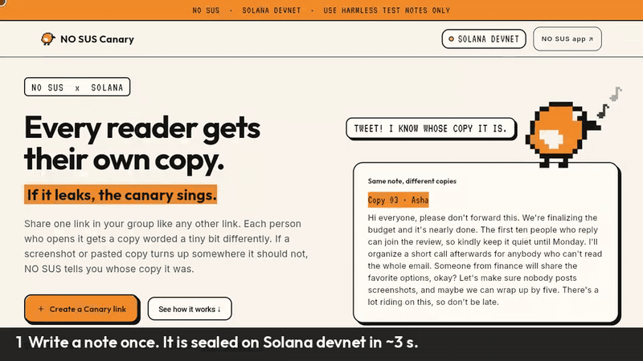
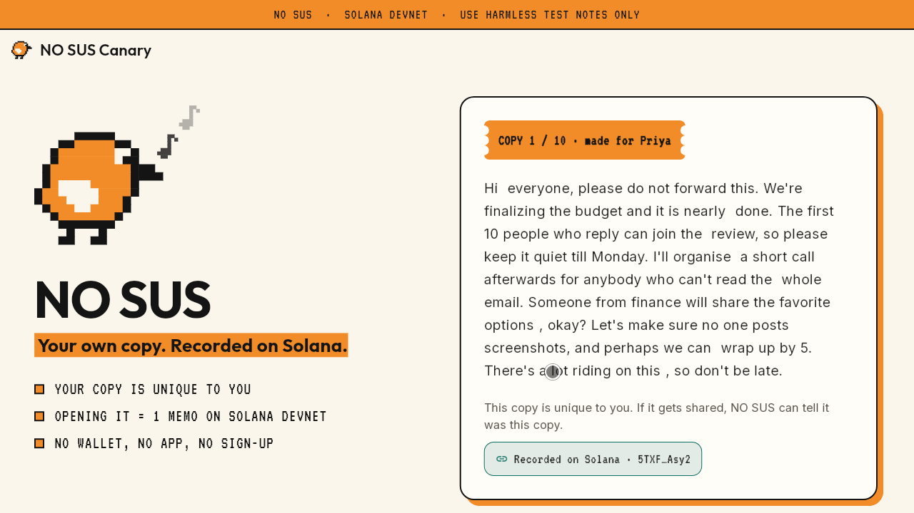
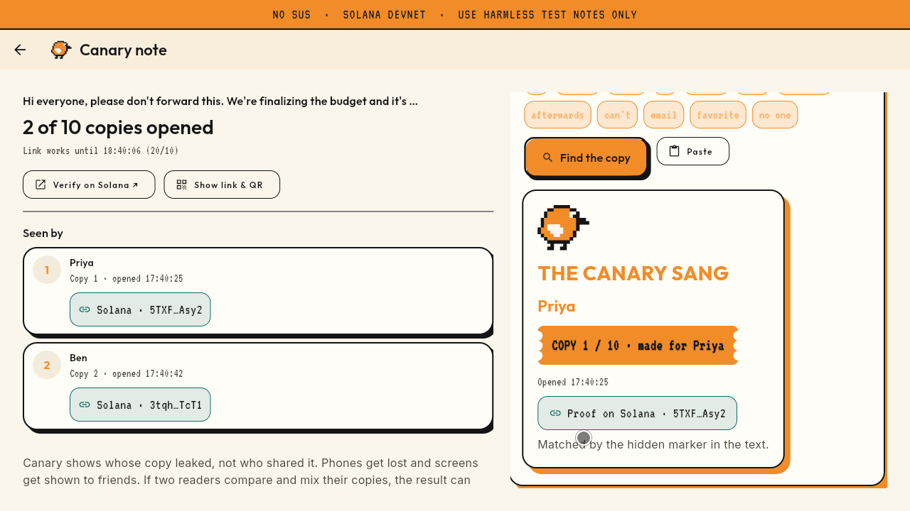
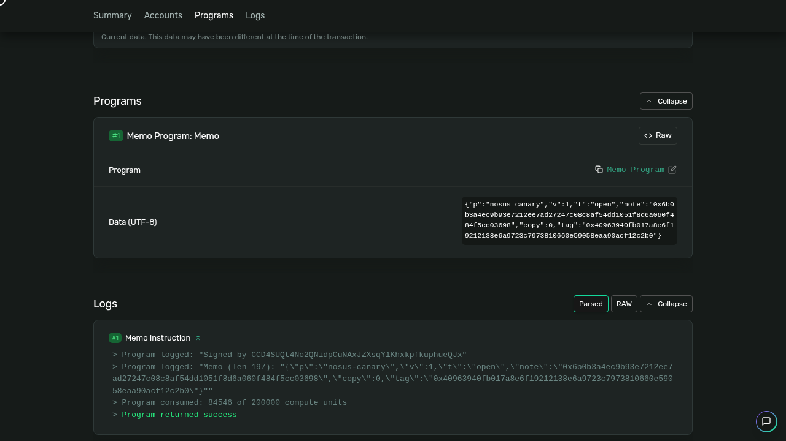
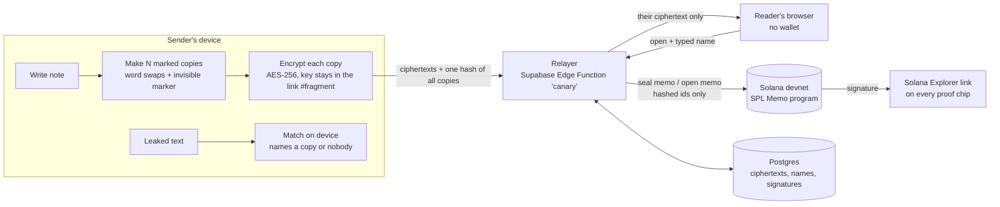

<p align="center">
  <a href="https://shubham-sahu.me/nosus-canary/"></a>
</p>

<p align="center">
  <a href="https://github.com/https-shubhamsahu/nosus-canary/actions/workflows/ci.yml"></a>
  <a href="https://explorer.solana.com/address/CCD4SUQt4No2QNidpCuNAxJZXsqY1KhxkpfkuphueQJx?cluster=devnet"></a>
  <a href="https://shubham-sahu.me/nosus-canary/"></a>
  <a href="LICENSE"></a>
</p>

**NO SUS Canary lets you share a sensitive note with a group so that every reader gets a secretly
different copy, and every seal and every open is recorded as a Solana transaction. If a screenshot
leaks, NO SUS tells you whose copy it was.**

[**Live demo**](https://shubham-sahu.me/nosus-canary/) ·
[Pitch video (2:24)](https://github.com/https-shubhamsahu/nosus-canary/releases/download/v0.1.0/nosus-canary-pitch.mp4) ·
[Demo video (1:18)](https://github.com/https-shubhamsahu/nosus-canary/releases/download/v0.1.0/nosus-canary-demo.mp4) ·
[Judge FAQ](SUBMISSION.md) ·
[A real receipt on Solana Explorer](https://explorer.solana.com/tx/5TXFPfTDFWyVe98DVPph7r55uRdJAcih6vKMBBRJKA96KtWT7Q4MUoFQG6GwH8N1FFkiMMbZzPssGtqtoW3wAsy2?cluster=devnet) ·
[Security model](SECURITY.md)

<p align="center">
  
</p>
<p align="center"><sub>Recorded on the live site on 20 Oct 2026, no edits to the app.
Receipts from this run:
<a href="https://explorer.solana.com/tx/QqdiqT84UfFyHNhpfLrK32HfqbUB5vF8qtC4DiAQ7wZZGn2MkUVJGGpVPpgmk4MCxVLtkhmZm6rbuBxqyuL11wb?cluster=devnet">seal</a> ·
<a href="https://explorer.solana.com/tx/5TXFPfTDFWyVe98DVPph7r55uRdJAcih6vKMBBRJKA96KtWT7Q4MUoFQG6GwH8N1FFkiMMbZzPssGtqtoW3wAsy2?cluster=devnet">Priya's open</a> ·
<a href="https://explorer.solana.com/tx/3tqhYUQ2BppvWh6dy8q5u7U23NpZ7FqfAnd34B58GTriGVZXtykcPj1i4sF7bNh4t8ShnhQokySNz7Uwh7GMTcT1?cluster=devnet">Ben's open</a>.
<a href="docs/media/canary-demo.mp4">MP4 version</a>.</sub></p>

## The problem

Salary sheets, offer letters, investor decks, exam papers and internal memos leak as screenshots
and forwards. When they do, nobody can show whose copy it was. Name watermarks get cropped.
Document-security tools ask every reader to make an account or install an app, so people go back
to WhatsApp and email.

## The insight

Give every reader a slightly different copy (a "canary trap"), and make the record of who got
which copy something neither side can edit.

- **Small wording changes survive.** `do not` / `don't`, `5` / `five`, `until` / `till`, plus an
  invisible marker. They survive copy-paste, retyping into a chat and OCR, so even part of a
  leaked text points to one copy.
- **Receipts are now cheap and fast.** A Solana memo costs about 0.000005 SOL and confirms in about
  a second. That makes one neutral, timestamped receipt per reader affordable. A row in our own
  database is only our word.

## The product

| | What happens | Where it runs |
|---|---|---|
| **1. Write once** | You write the note. Canary makes up to 100 copies that read the same but are each unique, and encrypts them. A **seal** memo goes to Solana with one hash of all copies. | Your browser (AES-256, key only in the link's `#fragment`) + relayer |
| **2. Share one link** | Each reader types a name and gets the next unused copy. An **open** memo goes to Solana with an anonymous tag. **Readers need no wallet, no app and no sign-up.** | Reader's browser + relayer |
| **3. Catch a leak** | Paste the leaked text (or part of it). Canary names the copy, or names nobody if too little survived. | Your device only |

<table>
  <tr>
    <td width="33%"></td>
    <td width="33%"></td>
    <td width="33%"></td>
  </tr>
  <tr>
    <td align="center"><sub>Each reader gets their own copy</sub></td>
    <td align="center"><sub>A pasted leak names the copy</sub></td>
    <td align="center"><sub>Every open is a memo on Solana</sub></td>
  </tr>
</table>

## Traction

We are early: live, pre-revenue, devnet only.

- **Canary on Solana devnet:** live at [shubham-sahu.me/nosus-canary](https://shubham-sahu.me/nosus-canary/)
  since 10 Oct 2026. The relayer has written **31 receipts** so far (20 Oct 2026), all from our own
  tests and demos. Every one is public on the
  [relayer's account page](https://explorer.solana.com/address/CCD4SUQt4No2QNidpCuNAxJZXsqY1KhxkpfkuphueQJx?cluster=devnet).
- **Parent product, [NO SUS](https://nosus.foo):** a privacy app for notes and files that open once
  and are watermarked with the viewer's name. In production since July 2026 (Google Play closed
  test, APK and web), 10+ releases. On 10 Oct 2026: 18 registered users, 6 active in the last 30
  days.

## Why Solana

1. **Cost per open.** A receipt is one SPL Memo instruction with one signature, so it pays the
   5,000-lamport base fee (0.000005 SOL). One receipt per reader stays affordable even for a
   100-reader note.
2. **Speed.** Receipts confirm in about a second, so the sender sees "opened" while the reader is
   still reading. In the recording above, the sealed link was ready about 3 s after clicking
   Create, including encryption and confirmation.
3. **Neutral and append-only.** Once written, neither the sender, the reader nor NO SUS can edit
   a receipt. Anyone can check it on Solana Explorer without trusting our database.
4. **No program to audit, no wallet to install.** We use the standard SPL Memo program, which
   Explorer shows as plain text. The relayer pays fees, so readers never see a wallet.
5. **Room to scale.** Batching many opens into one transaction (Merkle roots, state compression)
   and the Solana dApp Store for the Android app are both on the roadmap below.

## Architecture



| Where | What it holds | What it never holds |
|---|---|---|
| Solana (public) | Hashed note id, copy count, one hash of all copies, expiry, copy number, salted reader tag | Note text, keys, names, device ids |
| Server (Supabase) | Encrypted copies, reader names and open times (shown to the sender), signatures | Note text, the decryption key |
| Sender's device | The note, every copy's fingerprint, the owner secret | — |
| The link | Note id and the AES key, in the `#fragment` (browsers never send it to a server) | — |

More: [docs/ARCHITECTURE.md](docs/ARCHITECTURE.md) and the receipt format in
[docs/RECEIPTS_SPEC.md](docs/RECEIPTS_SPEC.md).

## Receipts you can check now

| Receipt | Signature | Memo |
|---|---|---|
| Seal, 10 copies (20 Oct 2026) | [`QqdiqT84…uL11wb`](https://explorer.solana.com/tx/QqdiqT84UfFyHNhpfLrK32HfqbUB5vF8qtC4DiAQ7wZZGn2MkUVJGGpVPpgmk4MCxVLtkhmZm6rbuBxqyuL11wb?cluster=devnet) | `{"p":"nosus-canary","v":1,"t":"seal","note":"0x6b0b…3698","copies":10,"hash":"0x…","exp":…}` |
| Open, copy 1 (Priya) | [`5TXFPfTD…oW3wAsy2`](https://explorer.solana.com/tx/5TXFPfTDFWyVe98DVPph7r55uRdJAcih6vKMBBRJKA96KtWT7Q4MUoFQG6GwH8N1FFkiMMbZzPssGtqtoW3wAsy2?cluster=devnet) | `{"p":"nosus-canary","v":1,"t":"open","note":"0x6b0b…3698","copy":0,"tag":"0x4096…c2b0"}` |
| Open, copy 2 (Ben) | [`3tqhYUQ2…h7GMTcT1`](https://explorer.solana.com/tx/3tqhYUQ2BppvWh6dy8q5u7U23NpZ7FqfAnd34B58GTriGVZXtykcPj1i4sF7bNh4t8ShnhQokySNz7Uwh7GMTcT1?cluster=devnet) | same note, `"copy":1` |
| First seal ever (10 Oct 2026) | [`2BHqnuCx…FRk512bQ`](https://explorer.solana.com/tx/2BHqnuCxYyemfegHkncgTsQyMPjpyB9boD1XqYfD1Wtbcf51Fpy3y264UwGhnvRKtcxFKCaSAzHxLrDwFRk512bQ?cluster=devnet) | `"t":"seal"`, 3 copies |
| All receipts | [relayer `CCD4SUQt…hueQJx`](https://explorer.solana.com/address/CCD4SUQt4No2QNidpCuNAxJZXsqY1KhxkpfkuphueQJx?cluster=devnet) | |

Decode any receipt yourself, without our app or server:

```bash
deno run --allow-net packages/receipts-ts/cli.ts 5TXFPfTDFWyVe98DVPph7r55uRdJAcih6vKMBBRJKA96KtWT7Q4MUoFQG6GwH8N1FFkiMMbZzPssGtqtoW3wAsy2
```

## Run it locally in under 5 minutes

You need [Flutter](https://docs.flutter.dev/get-started/install) 3.47+ and Chrome. The app talks
to the hosted devnet backend with its public (publishable) key, so there is nothing else to set up.

```bash
git clone https://github.com/https-shubhamsahu/nosus-canary.git
cd nosus-canary/app
flutter pub get
flutter run -d chrome --dart-define=NOSUS_CANARY_ONLY=true
```

Run the checks that CI runs (add [Deno](https://deno.com) 2.x for the last three):

```bash
(cd app && flutter analyze && flutter test)
(cd packages/receipts-dart && dart pub get && dart analyze && dart test)
(cd packages/receipts-ts && deno test)
(cd app/supabase/functions/canary && deno check index.ts && deno test --allow-env)
```

Your own backend and relayer: [docs/SELF_HOSTING.md](docs/SELF_HOSTING.md). Secrets template:
[.env.example](.env.example).

## Security notes

- **On chain:** only sha256-based ids and hashes. The reader tag is salted with a server secret
  and bound to the note and copy, so tags can't be linked across notes. Never note text, keys,
  names or device ids.
- **On the server:** encrypted copies it cannot read (the key never leaves the link fragment),
  plus each reader's typed name and open time, which the sender sees.
- **On the sender's device:** the original note and the fingerprint of every copy. Leak matching
  runs here. Clearing browser data deletes it.
- **What a receipt proves:** that the NO SUS relayer recorded this seal or this open at this time,
  and that the note's copies were committed before anyone read them. It does **not** prove who a
  person is, that a human read the text, or who shared a leak. Canary names *whose copy* leaked.
- **Known limits:** it does not stop screenshots; a reader who rewrites the text in their own
  words can defeat it; two readers who blend their copies can confuse the match (measured rates
  in the threat model). Encryption is AES-256 in CTR mode without an authentication tag today;
  moving to AES-GCM is on the roadmap.
- **Secrets:** none in the repo. The whole history (46 commits, all branches) was scanned on
  20 Oct 2026; the only key found is the Supabase publishable key, which is public by design.

Full threat model and how to report a problem: [SECURITY.md](SECURITY.md).

## Roadmap

| Next | What | Status |
|---|---|---|
| **Mainnet** | Receipts on Solana mainnet-beta with priority fees, retries with backoff, and relayer key rotation | Devnet live |
| **Open-source receipts library** | `@nosus/receipts` (TypeScript) and `nosus_receipts` (Dart): encode, parse, send, fetch and verify Canary receipts, with shared test vectors | **v0.1 in [`packages/`](packages/)**; the live relayer runs it; not yet published to JSR, npm or pub.dev |
| **Solana dApp Store / Seeker** | Canary inside the NO SUS Android app, submitted to the Solana dApp Store | Android build exists; not submitted |
| **PDFs and images** | Per-copy marks for files, not only text | Not started |
| **Merkle / compressed batching** | Many opens in one transaction (a Merkle root per batch, or state compression) to cut cost at scale | Not started |
| **Authenticated encryption** | AES-GCM per copy, so a tampered copy fails to open | Not started |

## What's in this repo

| Path | What |
|---|---|
| [`app/`](app/) | The NO SUS Flutter app (web + Android). Canary lives in [`app/lib/features/canary/`](app/lib/features/canary/); the deployed site is the standalone build (`NOSUS_CANARY_ONLY=true`). |
| [`app/supabase/functions/canary/`](app/supabase/functions/canary/) | The relayer: one Supabase Edge Function (Deno) that stores ciphertexts and writes the Solana memos |
| [`app/supabase/migrations/`](app/supabase/migrations/) | Database schema, including `canary_notes` and `canary_copies` |
| [`packages/receipts-ts/`](packages/receipts-ts/) · [`packages/receipts-dart/`](packages/receipts-dart/) | The receipts library, v0.1, plus [shared test vectors](packages/test-vectors/) from real devnet transactions |
| [`docs/`](docs/) | Architecture, receipt spec, self-hosting, status and verification log |
| [`tool/solana-spike/`](tool/solana-spike/) | Script that sends a test seal and open memo to devnet with your own key |

## Team

**Shubham Sahu**, founder of NO SUS. B.E. Electronics & Computer Engineering, TSEC Mumbai (2028).
[nosus.foo](https://nosus.foo) · [shubhamsahu@nosus.foo](mailto:shubhamsahu@nosus.foo) ·
[LinkedIn](https://www.linkedin.com/in/shubhamsahu9372) · [X @isagi0011](https://x.com/isagi0011)

## License

[Apache-2.0](LICENSE). Use harmless test notes only on the devnet demo.
