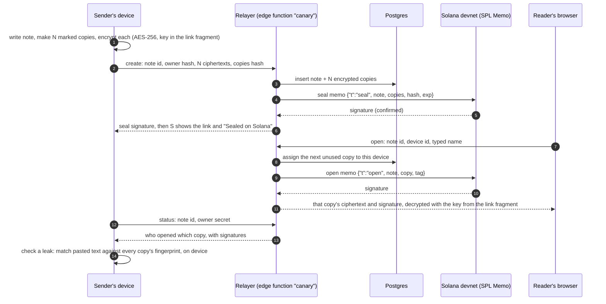

# Architecture

NO SUS Canary has three parts: the Flutter app (sender and reader), one Supabase Edge Function
called `canary` (the relayer), and Solana devnet (the receipts). The server stores only encrypted
copies; the chain stores only hashes.



## Components

| Part | Code | Notes |
|---|---|---|
| Sender and reader UI | `app/lib/features/canary/presentation/` | Flutter. The deployed site is the standalone build `--dart-define=NOSUS_CANARY_ONLY=true`. |
| Copy marking and leak matching | `app/lib/features/canary/domain/canary_fingerprint.dart` | Word-twin swaps (`do not`/`don't`, `5`/`five`, …) plus an invisible marker. Up to 100 copies. Matching never leaves the device and names nobody when unsure. |
| Encryption | `app/lib/features/canary/data/canary_crypto.dart` | AES-256 (`package:encrypt`, default SIC/CTR mode), random IV per copy. |
| Local store | `app/lib/features/canary/data/canary_store.dart` | The sender's notes, keys, salts and fingerprints, in browser storage. |
| Screenshot OCR | `app/lib/features/canary/ocr/` | Android only (ML Kit). |
| Relayer | `app/supabase/functions/canary/index.ts` | Actions `create`, `open`, `status`. Deployed with `--no-verify-jwt`; callers use the publishable key. |
| Which receipts to send | `app/supabase/functions/canary/gating.ts` | Pure rules, tested offline in `gating_test.ts`. |
| Solana receipts | `packages/receipts-ts` via `app/supabase/functions/canary/solana.ts` | `@solana/kit` 8.4, `@solana-program/memo` 0.15, v0 transactions, confirmed by polling `getSignatureStatuses`. |
| Schema | `app/supabase/migrations/20260919090000_nosus_canary.sql`, `20261010090000_nosus_canary_solana.sql` | `canary_notes`, `canary_copies`, `canary_assign_copy()`. RLS on, no `anon` grants. |

## Rules the relayer follows

- **A link is never handed out unsealed.** `create` returns only after the seal memo is confirmed.
  If the memo fails, `create` fails with `retry: true`, and a retry with the same note id reuses
  the stored copies.
- **An open is never lost.** If the open memo fails, the copy is still delivered and its
  signature is stored as `null`; the next open of that copy from the same device sends it again.
- **One device, one copy.** The device id is hashed and bound to one copy, so reopening shows the
  same copy and sends no new memo.
- **Limits.** 2–100 copies, links live 1 hour, 1 day or 7 days, names 1–40 characters,
  ciphertexts up to 12,000 characters.

## Receipt format

One SPL Memo instruction per transaction, compact JSON, hashes only. Full spec:
[RECEIPTS_SPEC.md](RECEIPTS_SPEC.md).

```text
seal: {"p":"nosus-canary","v":1,"t":"seal","note":"0x…","copies":10,"hash":"0x…","exp":1792501806}
open: {"p":"nosus-canary","v":1,"t":"open","note":"0x…","copy":0,"tag":"0x…"}
```

## Costs and timings (devnet, measured)

| | Value | Source |
|---|---|---|
| Fee per receipt | 5,000 lamports (0.000005 SOL) | Solana base fee for one signature; no priority fee is set |
| Compute per receipt | about 84,500 (open) to 91,600 (seal) CU | sampled receipts on Explorer |
| Memo size | 197 (open) to 218 (seal) bytes | Explorer |
| Confirmation | ~1.1 s | `tool/solana-spike`, 10 Oct 2026 |
| Click "Create" → sealed link | ~2.9 s | live recording, 20 Oct 2026 |

Security model and threat model: [../SECURITY.md](../SECURITY.md).
